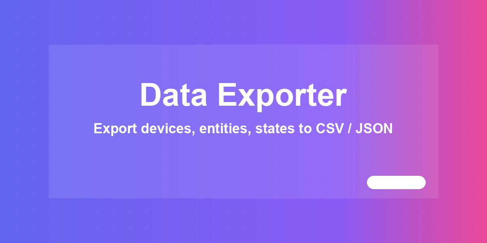
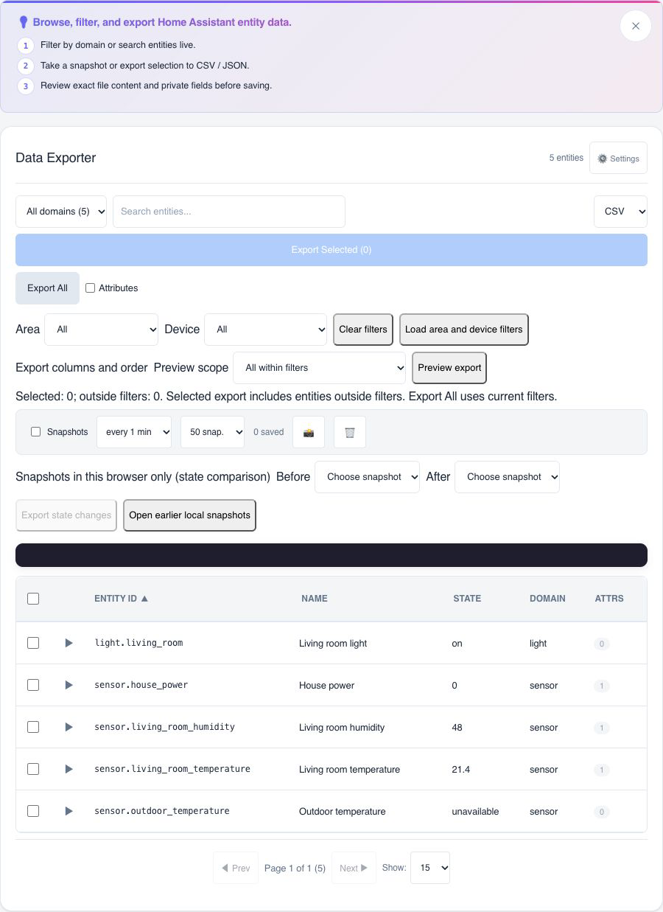
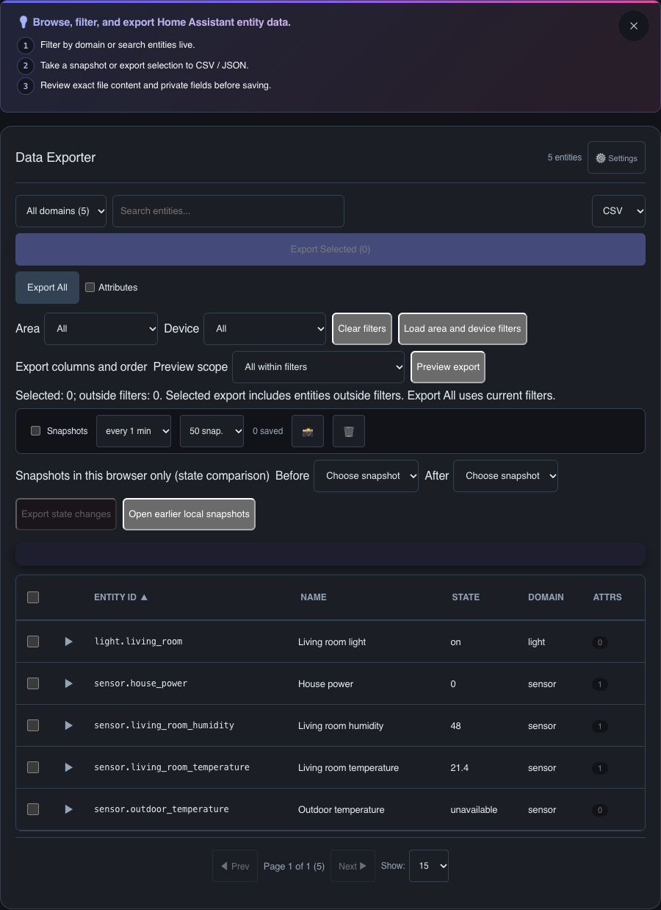
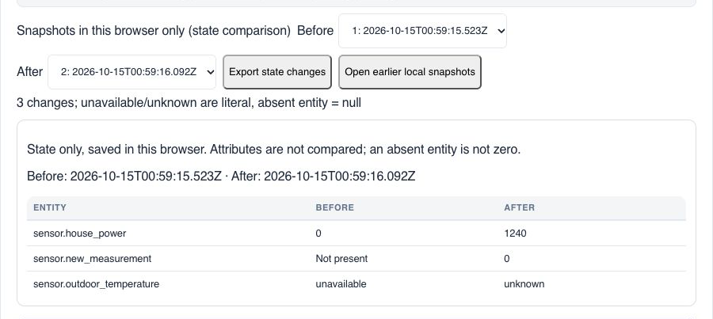

# 📤 Data Exporter



Browse, filter and export reviewed Home Assistant entity data to CSV / JSON /
YAML, with optional browser-local snapshots for state comparisons. Zero configuration: add the card and it lists every entity in your
instance.

[](https://github.com/MacSiem/ha-data-exporter/releases) [](LICENSE)

> Part of the [HA Tools](https://github.com/MacSiem) ecosystem — split into individual HACS-installable plugins.

## How it works

**Short version: it works automatically.** The card needs no configuration and
no extra integration:

1. **Entities from HA state.** On load, the card lists every entity from
   `hass.states` — domain filter, live text search, and sortable columns
   (Entity ID / Name / State / Domain / Attribute count).
2. **Attribute drill-down + 24h history.** Expanding a row shows its full
   attribute set and, on demand, its last 24h of state changes fetched from
   your own Home Assistant instance (`/api/history/period`).
3. **Export on your terms.** Choose selected entities or the current filtered
   scope, choose columns and their order, and review the exact JSON, CSV or YAML.
   Edit the filename before explicitly saving. Private fields start off for
   every export; opt in only when you need reviewed entity/device/area IDs and
   labels. An entity's own area takes precedence over its device's area.
4. **Optional local snapshots.** Capture states manually or at a chosen
   interval, then compare two saved snapshots. Changes and timestamps belong
   to this browser; they are not a reconstruction of Recorder history.

### Export and saved comparisons

The **Export** tab follows three steps: choose entities, open **Columns and
format** when needed, then use the single **Preview and save** action at the
bottom. Its scope selector chooses selected entities (including those hidden by
filters) or all entities within the current filters, across every page. Counts
show both scopes before you open the review dialog.

**+ Filter** opens area/device filters and loads the three Home Assistant
registries on first use. An unavailable registry disables these filters and
shows **Try again**; reopening the panel does not automatically retry. Remove an
active filter with its × button without losing selected entities.

**Records and comparison** contains manual/periodic snapshots, retention and
before/after comparison. Switching tabs preserves your choices and the running
snapshot interval. It does not take an extra snapshot.

Snapshot choices, comparison timestamps and expanded history show readable dates
with seconds and a time zone offset. The default time zone comes from your
system/browser. Your Home Assistant profile can explicitly choose server time,
12/24-hour time and system date formatting. Repeated hours during daylight-saving
changes remain distinguishable. Raw timestamps and export values keep their
original representation.

### What is automatic vs. manual

| Automatic | Manual (optional) |
|---|---|
| Listing every entity, with domain counts | Filtering by domain / search text |
| Sortable table columns | Choosing selected rows or all within filters |
| Live entity count + pagination (15/25/50/100 per page) | Choosing export format: CSV / JSON / YAML |
| Theme follows your Home Assistant theme (light/dark) | Including attributes in the export |
| Confirming before an export leaves your device | Enabling periodic local snapshots + interval/retention |

## Screenshots

| Light | Dark |
|---|---|
|  |  |

*Version 4.2.0 with synthetic demonstration data: domain/search and area/device filters,
sortable rows, reviewed export controls and browser-local snapshots. Dark mode follows
your Home Assistant theme. These screenshots contain no live household data.*



*Compare only changed states with both saved timestamps. Missing entities are explicit;
`0`, `unavailable` and `unknown` keep their distinct meanings. The export contains the
complete comparison, including changes beyond the visible page.*

## Installation

**Data Exporter is in the HACS default store** (category: **Plugin** / Lovelace dashboard resource) — no custom repository needed:

1. Open **HACS** in Home Assistant
2. Search for **Data Exporter**
3. Install and refresh your browser

[](https://my.home-assistant.io/redirect/hacs_repository/?owner=MacSiem&repository=ha-data-exporter&category=plugin)

## Quick start

```yaml
type: custom:ha-data-exporter
```

That's it — no options are required. Optional config:

```yaml
type: custom:ha-data-exporter
title: Data Exporter
default_format: csv        # csv | json | yaml
domains:                    # restrict the browser to specific domains
  - sensor
  - light
  - switch
storage_key: living_room    # separate snapshot storage per card instance
```

### Optional sidebar panel (`configuration.yaml`)

```yaml
panel_custom:
  - name: ha-data-exporter
    sidebar_title: Data Exporter
    sidebar_icon: mdi:home-assistant
    url_path: ha-data-exporter
    js_url: /local/community/ha-data-exporter/ha-data-exporter.js
    embed_iframe: false
    config: {}
```

After restart, **Data Exporter** appears in the HA sidebar.

The visual editor supports title, domains, default format, page size, attribute
visibility and `storage_key`. Other YAML options remain preserved. Page size must
be an integer from 1 to 1000; domains are a comma-separated list in the editor.

The **Settings** button opens the suite settings when embedded in HA Tools Panel.
In a standalone card it shows configuration guidance; administrators edit the card
in the dashboard, while other users can change the export and snapshot controls.

## Features

- Browse every entity in your instance with a live domain filter and text search.
- Sortable table — Entity ID, Name, State, Domain, Attribute count; keyboard
  sort controls and named selection checkboxes. Narrow containers show records
  with ID, name and state together.
- Expandable per-entity attribute view, plus on-demand 24h state history from
  Home Assistant's own history API.
- Export selected entities, or everything currently filtered, to **CSV, JSON
  or YAML** — with reviewed attributes and opt-in device/area metadata. Choose
  columns and their order, and filter by loaded area/device metadata.
  Selected entities remain selected when search or domain filters hide them; exports
  still respect the card’s configured `domains` and omit entities that no longer exist.
- CSV protects spreadsheet cells containing formula-like text; numeric values
  stay numeric.
- Native review dialog before every export, with editable filename, format,
  Included/Excluded lists and exact file preview. A download handoff remains
  unconfirmed when the browser cannot confirm the filesystem result.
- Optional periodic snapshots (30s–1h interval, 20–200 kept) for a
  browser-local state comparisons, independent of HA's recorder. Select two
  snapshots and export changed states with their observed timestamps.
- Bundled Bento Design System (light + dark mode, follows your HA theme, mobile-friendly).
- Self-contained — no shared HA Tools dependency.
- Tool settings, snapshots and dismissed-banner state are cached in browser `localStorage`.

## FAQ

**Do I have to configure anything?**
No. Add the card and it lists every entity in your Home Assistant instance by itself.

**Does this send my data anywhere?**
No third-party or cloud calls. Area/device filters load registries from your
own Home Assistant only when requested. Exporting reviewed private metadata
can read those registries; unavailable or refused metadata stays explicit.
Expanding an entity row loads its 24h history from your own Home Assistant REST
API (`/api/history/period`). Files are prepared in your browser and are never
uploaded. The review dialog starts with names and IDs excluded. Tokens, users,
addresses, raw configuration and arbitrary text states/attributes stay excluded
in every mode, including private opt-in. Numeric values, reviewed enums, units
and timestamps follow the export policy; missing or excluded cells are null.

**Where are snapshots stored?**
In your browser's `localStorage`, per browser and per device. Clearing browser
data removes them. Exports can contain current filtered/selected entity data
or state changes between two explicitly chosen local snapshots. The latter
includes observed states and timestamps, without interpolation or a claim of
complete server history.
The same Home Assistant origin and browser profile share this storage across
accounts. Clear snapshots before handing that profile to another person;
`storage_key` separates cards, not user accounts.

**Can I keep separate snapshot histories per card instance?**
Yes — set `storage_key: <name>` in the card YAML. Snapshots *and* snapshot
settings (interval, retention, enabled state) are stored in `localStorage`
under that name, so each card with its own `storage_key` gets an independent
snapshot namespace. Cards without a `storage_key` all share the `default`
namespace.

**Which export formats are supported?**
CSV, JSON and YAML, selectable in the review dialog. Reviewed attributes are
optional. JSON and YAML contain a report wrapper and `rows`; CSV includes report
metadata alongside row columns. Column choices and their order are preserved.
Unknown attribute or column names cannot introduce raw fields into the file;
unreviewed columns use `excluded-column-N` and null values. CSV formula-like
text remains inert while numeric values retain their sign and zero.

**Can I limit the browser to specific domains?**
Yes — set `domains: [sensor, light, ...]` in the card YAML (see Quick start).

## Changelog

See [CHANGELOG.md](CHANGELOG.md).

## Support

If this tool makes your Home Assistant life easier, consider supporting the project:

- [☕ Buy Me a Coffee](https://buymeacoffee.com/macsiem)
- [💳 PayPal](https://www.paypal.com/donate/?hosted_button_id=Y967H4PLRBN8W)

The optional in-card support link is shown only to administrators. Dismiss it in the card or set `show_support: false` in the card configuration.

## License

MIT — see [LICENSE](LICENSE).

## Privacy and data

Exports contain only reviewed fields. Names and entity/device/area identifiers
require explicit consent for each export; credentials, users, addresses and raw
configuration remain excluded. Review the exact file preview before saving.
Keep exports private and use synthetic records when reporting a bug.

See [SECURITY.md](SECURITY.md) for safe vulnerability reporting and [NOTICE](NOTICE) for licensing notices.

The entity table, filters, export toolbar, pagination, first-run guidance and optional support labels follow the Home Assistant language (Polish or English, including Polish regional locales). Ordinary language updates preserve the focused search and text selection, selected entities, format, attribute choice and dismissed guidance/support.

Snapshot exports retain the privacy decision made when each new snapshot was
captured. Renaming or deleting an entity does not expose a state that was
identified as a credential by its original name. Older snapshots do not contain
that classification: their numeric states are omitted from reviewed exports,
while known enum/unavailable states remain. Existing local history is not
rewritten or deleted, and new ordinary numeric measurements retain zero values.

Snapshot comparison shows changed states and both saved timestamps directly in the card, with 20 changes per page. Missing entities are explicit and attributes are not compared; the reviewed export includes the complete comparison.
